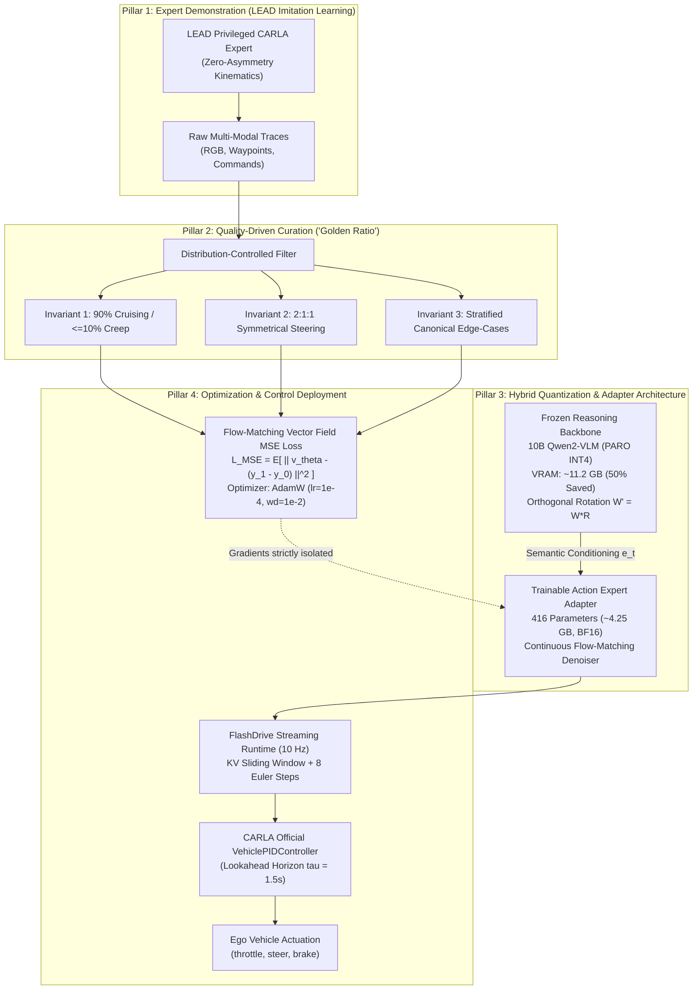
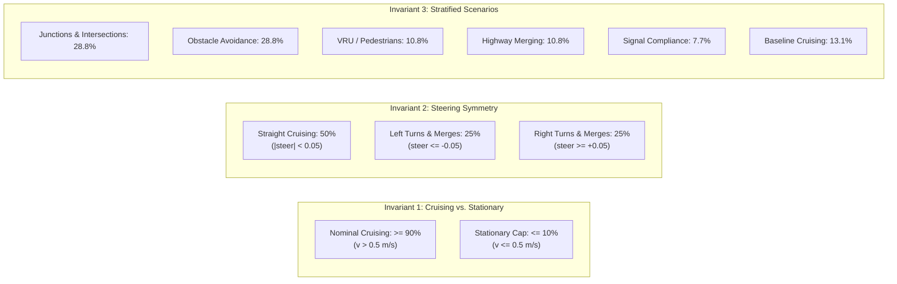

# Section 3: Methodology

In this section, we present the methodology for data-efficient, real-time safety alignment in Vision-Language-Action (VLA) driving models. Our methodology is structured around four interconnected pillars:
1. **Asymmetry-Free Imitation Learning (Section 3.1 & 3.3):** Leveraging the LEAD framework to extract kinematically feasible expert demonstrations across canonical challenge scenarios.
2. **Quality-Driven Data Curation (Section 3.2 & 3.3):** The "Golden Ratio" curation framework that mathematically prevents *Prior Collapse* and resolves the *Hazard-Flooding Paradox*.
3. **Parameter-Isolated Adapter Optimization (Section 3.4):** Freezing the 10-billion parameter vision-language reasoning backbone while isolating gradient descent strictly to the 416-tensor continuous Flow-Matching Action Expert using AdamW and vector field MSE loss.
4. **Memory-Efficient Hybrid Quantization via PARO (Section 3.5):** Employing Pairwise Rotation Quantization (W4A8) to halve the VLM's memory footprint ($21\text{ GB} \to 11.2\text{ GB}$) with zero degradation in semantic reasoning, enabling closed-loop 10 Hz streaming control on a single consumer GPU.

---

## 3.1 Problem Formulation & System Architecture

Autonomous vehicle control requires mapping high-dimensional visual observations and topological instructions into smooth, collision-free future trajectories.

### 3.1.1 Multi-Modal State Representation
At discrete control step $t$, the ego vehicle receives:
1. **Surround Camera Stream:** $\mathcal{I}_t = \{I_t^{(i)}\}_{i=1}^M$, where $I_t^{(i)} \in \mathbb{R}^{H \times W \times 3}$ denotes the RGB image from camera view $i \in \{1, \dots, M\}$.
2. **Kinematic History:** $\mathcal{H}_t = \{(x_\tau, y_\tau, \theta_\tau, v_\tau)\}_{\tau=t-T_{\text{hist}}}^t \in \mathbb{R}^{T_{\text{hist}} \times 4}$, representing past vehicle coordinates, yaw orientation, and velocity over an observation buffer of $T_{\text{hist}} = 16$ steps ($1.6\text{ s}$).
3. **High-Level Navigation Command:** $c_t \in \mathcal{C}$, encoding discrete categorical route directives (e.g., `LANE_FOLLOW`, `TURN_LEFT`, `TURN_RIGHT`, `CHANGE_LANE`).

### 3.1.2 Continuous Action Space via Trajectory Parameterization
Instead of discretizing continuous motor controls into autoregressive text tokens—which introduces severe compounding discretization error—we parameterize actions as a continuous trajectory in the vehicle's local SE(2) coordinate frame:
$$\mathbf{Y} = [\mathbf{y}_1, \mathbf{y}_2, \dots, \mathbf{y}_K]^\top \in \mathbb{R}^{K \times 3}, \quad \mathbf{y}_k = (x_k, y_k, z_k)$$
where $K = 64$ waypoints spaced at uniform intervals of $\Delta t = 0.1\text{ s}$, defining a continuous temporal planning horizon of $T_{\text{plan}} = 6.4\text{ seconds}$.

### 3.1.3 Conditional Flow-Matching Action Expert
To model multi-modal trajectory distributions without the training instability of standard diffusion or GANs, we formulate trajectory generation via **Conditional Flow Matching (CFM)**. 

Let $p_0(\mathbf{Y}_0) = \mathcal{N}(0, \mathbf{I})$ denote standard Gaussian noise and $p_{\text{data}}(\mathbf{Y}_1)$ denote the distribution of kinematically feasible expert trajectories. A continuous probability path $\mathbf{Y}_s$ for $s \in [0, 1]$ connects noise to clean trajectories via optimal-transport interpolation:
$$\mathbf{Y}_s = (1 - s)\mathbf{Y}_0 + s\mathbf{Y}_1$$
The time-dependent vector field governing this flow is parameterized by the Action Expert $v_\theta$:
$$\frac{d\mathbf{Y}_s}{ds} = v_\theta(\mathbf{Y}_s, s \mid \mathbf{e}_t, \mathcal{H}_t)$$
where $\mathbf{e}_t = \Phi_{\text{VLM}}(\mathcal{I}_t, \mathcal{H}_t, c_t)$ is the conditioning representation extracted from the vision-language backbone.

---

## 3.2 Theoretical Formulation: Prior Collapse & The Hazard-Flooding Paradox

We now formalize the failure mechanism of naive imitation learning when models are over-trained on hazard scenarios.

### 3.2.1 Nominal Cruising Prior
Under normal road conditions, safe human driving is governed by a mode-stable nominal cruising prior. Let the trajectory velocity components be:
$$\dot{\mathbf{y}}_k = \left( \dot{x}_k, \dot{y}_k \right) = \left( \frac{x_{k+1} - x_k}{\Delta t}, \frac{y_{k+1} - y_k}{\Delta t} \right)$$
Nominal driving operates under a narrow Gaussian prior characterized by forward progression and minimal lateral variance:
$$p_{\text{nom}}(\dot{\mathbf{y}}) = \mathcal{N}\left( \begin{bmatrix} v_{\text{cruise}} \\ 0 \end{bmatrix}, \begin{bmatrix} \sigma_x^2 & 0 \\ 0 & \sigma_y^2 \end{bmatrix} \right), \quad \text{where } \sigma_y^2 \ll \sigma_x^2$$

### 3.2.2 Mechanism of Prior Collapse (Lateral Gradient Leakage)
When an imitation learning dataset is artificially flooded with safety-critical edge cases (sudden obstacle swerves, cut-in reactions, and panic avoidance), the empirical training distribution shifts to a mixture:
$$p_{\text{train}}(\mathbf{Y}) = (1 - \alpha) p_{\text{nom}}(\mathbf{Y}) + \alpha p_{\text{hazard}}(\mathbf{Y})$$
where $\alpha \in [0, 1]$ represents the hazard-flooding proportion.

In hazard scenarios ($p_{\text{hazard}}$), evasive trajectories exhibit massive lateral velocity shifts ($\dot{y} \gg 0$) coupled with emergency decelerations ($\dot{x} \to 0$). When a generative flow field $v_\theta$ is trained on an uncurated mixture where $\alpha$ is high:
1. **Prior Collapse:** The base velocity distribution $p_{\text{nom}}$ is suppressed, flattening the energy landscape around stable straight cruising.
2. **Lateral Gradient Leakage:** The vector field learns a non-vanishing lateral velocity gradient during emergency braking states:
   $$\mathbb{E}_{v_\theta}[\dot{y} \mid \text{hazard}] \neq 0$$
   Consequently, when the closed-loop agent encounters a sudden obstacle requiring pure in-lane stopping ($\dot{x} \to 0, \dot{y} = 0$), the collapsed prior outputs an erroneous lateral swerve component, causing the downstream controller to steer violently into curbs, parked cars, or oncoming traffic.

### 3.2.3 Formal Statement of the Hazard-Flooding Paradox
> **The Hazard-Flooding Paradox:** In continuous-action Flow-Matching policies, over-indexing on emergency evasions degrades the mode stability of the nominal cruising prior. Beyond a critical fraction $\alpha^*$, scaling hazard data causes closed-loop collision frequencies to regress toward or exceed the error rate of an unadapted baseline.

This theoretical formulation directly explains the empirical regression observed in Table 2, where quadrupling hazard-flooded data from 1,600 to 6,400 samples caused collisions to surge by $+16.3\%$ ($49 \to 57$), completely regressing to the zero-shot base model error rate.

---

## 3.3 Quality-Driven Data Curation: The "Golden Ratio" Framework

To eliminate Prior Collapse while supplying sufficient coverage of safety-critical edge cases, we formulate the **Distribution-Controlled Curation Framework**. All demonstration traces are collected using the **LEAD** (*Learner-Expert Asymmetry Decoupling*) privileged rule-based expert in CARLA 0.9.15, guaranteeing kinematically optimal, dynamically feasible ground-truth trajectories $\mathbf{Y}_1$.

The curation framework enforces three strict geometric and behavioral invariants over the training budget ($N = 1,600$ samples):

### 3.3.1 Invariant 1: Cruising Prior Anchor & Stationary Cap (90/10 Rule)
Uncurated urban datasets contain up to $40\%$ zero-velocity frames (waiting at traffic lights, gridlocked queues), which induces an aggressive "creep bias" or premature stop-out behavior. We enforce:
$$\frac{|\{ (\mathbf{x}, \mathbf{Y}) \in \mathcal{D}_{\text{train}} \mid v_{\text{ego}} > 0.5\text{ m/s} \}|}{|\mathcal{D}_{\text{train}}|} \ge 0.90$$
$$\frac{|\{ (\mathbf{x}, \mathbf{Y}) \in \mathcal{D}_{\text{train}} \mid v_{\text{ego}} \le 0.5\text{ m/s} \}|}{|\mathcal{D}_{\text{train}}|} \le 0.10$$
This preserves high-speed cruising stability while restricting stationary frames strictly to legitimate stop-line scenarios.

### 3.3.2 Invariant 2: Bilateral Steering Symmetry (2:1:1 Ratio)
Naturalistic driving is heavily straight-dominated (>70%), causing uncurated models to develop a severe "straight bias" (blowing through intersections without turning). We enforce a strict **2:1:1 directional ratio**:
$$P(\text{Straight}) = 0.50, \quad P(\text{Turn Left}) = 0.25, \quad P(\text{Turn Right}) = 0.25$$
For obstacle detours (`ConstructionObstacle`, `ParkedObstacle`), the initial obstacle bypass is classified under $\mathcal{D}_{\text{left}}$, and the return lane merge is classified under $\mathcal{D}_{\text{right}}$, ensuring exact zero-mean lateral symmetry:
$$\int_{\mathcal{D}_{\text{train}}} \dot{y}_k \, d\mathcal{D} \approx 0$$

### 3.3.3 Invariant 3: LEAD Stratified Scenario Allocation
The 1,600 training frames are stratified across the 6 canonical challenge classes defined in LEAD:
* **Turning & Junctions ($28.8\%$, 460 frames):** Uncontrolled priority yielding and protected signalized turns.
* **Obstacle Bypass & Avoidance ($28.8\%$, 460 frames):** Static construction detours and parked car bypasses without lane departure.
* **VRUs & Dynamic Conflicts ($10.8\%$, 173 frames):** Strict in-lane longitudinal emergency braking for crossing pedestrians and cyclists.
* **Highway Merging & Flow ($10.8\%$, 173 frames):** Gap selection and acceleration on highway on-ramps.
* **Signal Compliance ($7.7\%$, 124 frames):** Stop-bar compliance at red lights.
* **General Lane Maintenance ($13.1\%$, 210 frames):** Nominal lane-keeping on open roads.

---

## 3.4 Parameter-Isolated Adapter Optimization

To prevent catastrophic forgetting of language comprehension and achieve extreme computational efficiency, training is strictly decoupled between the semantic backbone and the action generator.

### 3.4.1 Decoupled Parameter Partitioning
The total model parameter space $\Theta$ is partitioned into two disjoint sets:
$$\Theta = \Theta_{\text{frozen}} \cup \theta_{\text{expert}}$$
* **Frozen VLM Backbone ($\Theta_{\text{frozen}}$):** The 10B Vision-Language Model (Qwen2-10B + Vision Transformer) is quantized to 4-bit precision via PARO and completely frozen. No weights or LoRA adapter matrices in $\Theta_{\text{frozen}}$ receive gradient updates.
* **Trainable Action Expert ($\theta_{\text{expert}}$):** Fine-tuning is isolated strictly to the **416 Action Expert parameter tensors ($\approx 4.25\text{ GB}$ in `bfloat16`)**, which encompass the waypoint input/output projections (`PerWaypointActionInProjV2`), diffusion denoiser transformer blocks, and delta trajectory tokenizer.

### 3.4.2 Training Objective: Vector Field Flow-Matching MSE Loss
The Action Expert parameters $\theta_{\text{expert}}$ are optimized using the conditional Flow-Matching Mean Squared Error (MSE) objective:
$$\mathcal{L}_{\text{MSE}}(\theta_{\text{expert}}) = \mathbb{E}_{s \sim \mathcal{U}[0, 1],\, \mathbf{Y}_0 \sim \mathcal{N}(0, \mathbf{I}),\, (\mathbf{x}, \mathbf{Y}_1) \sim \mathcal{D}_{\text{train}}} \left[ \Big\| v_{\theta_{\text{expert}}}(\mathbf{Y}_s, s \mid \mathbf{e}_t, \mathcal{H}_t) - (\mathbf{Y}_1 - \mathbf{Y}_0) \Big\|_2^2 \right]$$
where $\mathbf{Y}_s = (1 - s)\mathbf{Y}_0 + s\mathbf{Y}_1$ is the interpolated trajectory state at diffusion time $s \in [0, 1]$.

### 3.4.3 Optimization Hyperparameters (AdamW)
Training is performed using the **AdamW** optimizer with decoupled weight decay:
* **Initial Learning Rate:** $\eta_0 = 1.0 \times 10^{-4}$ with linear warmup over the first $10\%$ of steps, followed by cosine annealing decay to $\eta_{\text{min}} = 1.0 \times 10^{-6}$.
* **Optimizer Betas:** $\beta_1 = 0.9, \ \beta_2 = 0.95$
* **Weight Decay:** $\lambda = 1.0 \times 10^{-2}$
* **Gradient Clipping:** Maximum $\ell_2$-norm threshold $\|g\|_2 \le 1.0$
* **Compute Cost:** Optimization converges in under **$2\text{ hours}$ on a single consumer GPU (NVIDIA RTX 4090, 24 GB VRAM)**, demonstrating that motor alignment in VLAs does not require large-scale compute clusters.

---

## 3.5 Memory-Efficient Hybrid Inference via PARO Quantization & Control Coupling

To achieve real-time 10 Hz closed-loop control in CARLA on consumer-grade hardware, we introduce a hybrid-precision inference architecture.

### 3.5.1 PARO: Pairwise Rotation Quantization for the VLM Backbone
Standard INT4 quantization of 10B+ models degrades semantic reasoning due to extreme activation outliers. We employ **PARO** (*Pairwise Rotation Quantization*), which applies learned orthogonal rotation matrices $\mathbf{R} \in \mathbb{R}^{d \times d}$ ($\mathbf{R}\mathbf{R}^\top = \mathbf{I}$) to weight matrices $\mathbf{W}$ and activation vectors $\mathbf{X}$:
$$\mathbf{W}' = \mathbf{W}\mathbf{R}, \quad \mathbf{X}' = \mathbf{R}^\top \mathbf{X}$$
Because the transformation is orthogonal:
$$\mathbf{W}' \mathbf{X}' = (\mathbf{W}\mathbf{R})(\mathbf{R}^\top \mathbf{X}) = \mathbf{W}\mathbf{I}\mathbf{X} = \mathbf{W}\mathbf{X}$$
This mathematically preserves the linear mapping while rotating paired feature channels to disperse concentrated activation spikes. PARO compresses the 10B VLM to **INT4 (W4A8)** with **zero loss in semantic reasoning accuracy**, slashing the backbone VRAM footprint from **$21\text{ GB}$ to $11.2\text{ GB}$** (a $46.7\%$ reduction).

### 3.5.2 Hybrid-Precision Runtime Architecture
The deployed inference engine operates under a hybrid-precision split:

| Subsystem | Model Component | Precision | VRAM Footprint | Functional Role |
| :--- | :--- | :---: | :---: | :--- |
| **Semantic Reasoning** | VLM Backbone (Qwen2-10B) | **PARO INT4 (W4A8)** | **$\sim 11.2\text{ GB}$** | Frozen semantic reasoning & Chain-of-Thought (zero accuracy drop) |
| **Continuous Control** | Action Expert (Flow Denoiser) | **Native BF16** | **$\sim 4.25\text{ GB}$** | Fine-tuned 64-waypoint continuous trajectory generation |
| **Total Model System** | **Hybrid VLA** | **W4A8 + BF16** | **$\approx 15.5\text{ GB}$** | **Fits on a single 24 GB GPU (RTX 4090) with CARLA running** |

### 3.5.3 FlashDrive Streaming & CARLA Closed-Loop Control
1. **FlashDrive Streaming Engine:** Implements sliding-window KV-cache reuse, executing Euler trajectory integration ($S = 8$ flow steps) at a steady-state latency of **$\sim 45\text{ ms}$ ($\sim 22\text{ FPS}$)**, comfortably satisfying CARLA's 10 Hz real-time requirement.
2. **Downstream Control Coupling:** The generated 64 waypoints are tracked by CARLA's official `VehiclePIDController` using a dynamic lookahead horizon $d_{\text{lookahead}} = \max(3.5\text{ m}, 1.5\text{ s} \cdot v_{\text{current}})$. Lateral steering is actuated via heading error PID, while longitudinal throttle/braking tracks the target waypoint velocity.

Because the downstream controller is invariant across all evaluations, all gains in driving score and collision avoidance are strictly attributable to the **distribution-controlled curation of the Action Expert**.
